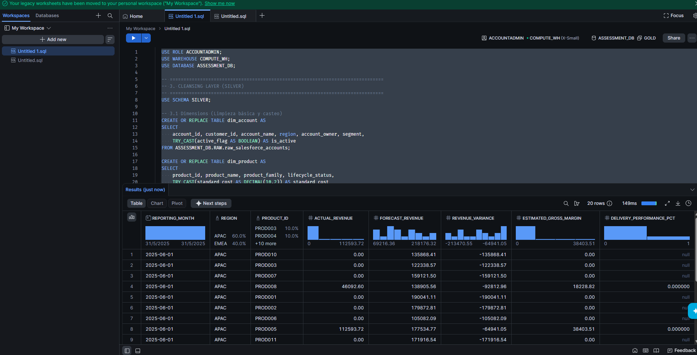

# Snowflake Analytical Data Engineering Solution

**Candidate:** Estivent Chacón | **Role:** Senior Data Engineer | **Location:** Alajuela, CR
**Submission:** Option A (GitHub Repository) 

## Project Overview:
This repository contains the technical assessment for the Senior Data Engineer role. The objective is to design and implement a Snowflake-based analytical solution to support business reporting, handling intentionally injected data quality issues.

## 1. End-to-End Architecture & Flow
For this Snowflake analytical solution, I am proposing a **Medallion Architecture (Bronze/Raw, Silver, Gold)**. This structure guarantees data lineage, error isolation, and analytical flexibility.

[CSV Files] -> STG_LANDING (Internal Stage)
     | (COPY INTO with Lineage: _source_file, _row_number, _loaded_at)
     v
RAW (Bronze) -> 1:1 replica of source (VARCHAR). Schema is permanent for audit/Time Travel.
     | (TRY_CAST, Cleansing, Deterministic Deduplication, Orphan Handling)
     v
SILVER -> Typed, cleansed dimensions and facts. Schema is TRANSIENT.
     | (Aggregation to Month x Region x Product, FULL OUTER JOIN)
     v
ANALYTICS (Gold) -> Business mart (`mart_revenue_performance`). Schema is TRANSIENT.

## 2. Data Model & Grain Declaration
The proposed model is a **Star Schema** optimized for high-performance analytical queries in Snowflake.

*   **`RAW` tables:** Transactional (1:1 with source files).
*   **`SILVER.dim_account`:** Customer details, region, and segment.
*   **`SILVER.dim_product`:** Product family and `standard_cost`.
*   **`SILVER.fact_orders`:** Transactional (Item level per valid purchase order).
*   **`SILVER.fact_forecast`:** Monthly aggregated grain per region and product.
*   **`ANALYTICS.mart_revenue_performance`:** Aggregated to **Month × Region × Product**.

**Handling Granularity Differences:**
The main challenge is that orders are transactional (daily, per customer), while the forecast is monthly, per region and product. To solve this in the `mart_revenue_performance`, `fact_orders` data is **rolled up (aggregated)** to the `Month`, `Region`, and `Product` level. This enables a `FULL OUTER JOIN` with the forecast to accurately calculate *Revenue Variance*.

## 3. Data Quality (DQ) Strategy
Anomalies injected into the dataset were handled natively in the Silver layer:

1. **Missing Dates (`ORD90107`):** Order date is `NULL` after casting. 
   - *Resolution:* Handled as a Fatal Error; row dropped to prevent reporting misalignment.
2. **Duplicates (`ORD00005`):** Non-deterministic duplicate in source. 
   - *Resolution:* Deterministically deduplicated using the `_row_number` lineage column injected during the `COPY INTO` process (`QUALIFY ROW_NUMBER() OVER(PARTITION BY order_id ORDER BY _row_number ASC) = 1`).
3. **Orphan Records (`CUST999`, `PROD999`):** Orders with `customer_id` or `product_id` missing in dimension tables. 
   - *Resolution:* Keys defaulted to `'Unknown'`. Margins calculate to 0.00, but Top-Line Actual Revenue is preserved in financial reporting.
4. **Invalid Numeric Values:** Identified negative quantities (e.g., `-15`).
   - *Resolution:* Handled as a Fatal Error; dropped where `quantity <= 0`.
5. **Data Type Casting:** Text fields attempting to masquerade as numbers or dates.
   - *Resolution:* Used safe-casting functions (`TRY_CAST`) to gracefully handle nulls without breaking the pipeline.

## 4. Repository Structure:

The SQL scripts containing the transformation logic and the final analytical output can be found in the `sql/` directory:

*   `01_architecture_and_ingestion.sql`: Stage setup, least-privilege roles (`ASSESSMENT_ENGINEER`), `COPY INTO` with lineage, and Bronze layer table DDLs.
*   `02_silver_transformations.sql`: Deterministic deduplication, casting, DQ handling, and Star Schema creation in the Silver layer.
*   `03_gold_mart.sql`: Final aggregations, additive metrics, and FULL OUTER JOIN for the Gold layer business mart.
*   `README.md`: Project documentation.
*   `snowflake_results.png`: Evidence of successful script execution generating the final mart.

*Note: The SQL logic is provided as scripts, but in a production environment, this would be part of my dbt project.*

## 5. Key Decisions, Assumptions & Considerations

**Assumptions & Tradeoffs:**
*   **Least Privilege ([A08]):** Executed via a dedicated `ASSESSMENT_ENGINEER` role and an X-Small `ASSESSMENT_WH` (60s auto-suspend).
*   **Storage Cost Tradeoff ([A07]):** `RAW` is permanent for replayability. `SILVER` and `ANALYTICS` are `TRANSIENT` to save Fail-safe costs, as they are fully re-computable.
*   **File Loading ([A01]):** Used an Internal Stage due to assessment constraints. In production, this would be an External Stage (AWS S3) triggered by Snowpipe.

**Design Decisions:**
*   **Revenue Recognition:** `actual_revenue` is only recognized when `order_status` is 'Shipped'. 'Open' orders represent backlog.
*   **Gross Margin:** Calculated using the latest available `standard_cost`.
*   **Full Outer Join:** Used to compare actuals and forecasts, assuming forecasts might exist for unsold products or unexpected sales might occur without a forecast.

**Production & Enterprise Vision (Bonus):**
*   **dbt Project & Automated Testing:** The logic in `02` and `03` scripts translates directly into dbt models. I would implement generic tests (`not_null`, `unique`) on keys and singular tests (e.g., `qty > 0`) to enforce DQ.
*   **Data Lineage Documentation:** Inherently supported by the Medallion architecture (Raw -> Silver -> Gold). Tools like dbt docs or Monte Carlo would visualize this DAG.
*   **Data Reconciliation Controls:** Row-count and revenue-sum checks between Silver (`fact_orders`) and Gold (`mart_revenue_performance`) to ensure no revenue is dropped during the `FULL OUTER JOIN`.
*   **Incremental Processing Strategy:** Replacing `CREATE OR REPLACE` with `MERGE` statements (or dbt `is_incremental()`) using `order_date` as a water-mark for the `fact_orders` table.
*   **Snowflake Streams and Tasks:** Used for CDC (Change Data Capture) from the RAW layer, feeding only net-new records into the Silver layer automatically.
*   **CI/CD Concepts:** Leveraging GitHub Actions to run `sqlfluff` for linting and triggering a dry-run compilation before merging PRs into the main branch.
*   **Observability and monitoring framework:** Integration with Snowflake Alerts to notify Data Stewards via Slack/Email when Data Quality thresholds are exceeded.
*   **Power BI semantic model & Dashboarding:** The `mart_revenue_performance` acts as the direct import/DirectQuery source for Power BI. Row-Level Security (RLS) would be applied on the `dim_account.region` so regional managers only see their respective forecast variance.

## 6. Scalability & Production Considerations

While this assessment represents a static load, in a production environment, I would enhance this architecture with:

1. **Orchestration:** Using Snowflake Tasks or other tools like (Apache Airflow, Dagster) to automate the DAG execution.
2. **CI/CD:** Implement GitHub Actions to automate testing and deployment of SQL scripts (or dbt models) across DEV, QA, and PROD environments.
3. **Incremental Loading:** Transition from `CREATE OR REPLACE` to `MERGE` statements in the Silver and Gold layers to handle massive datasets efficiently.

## Execution Evidence:

